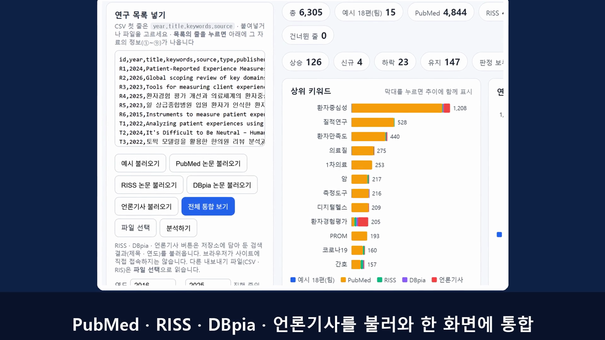

# research-trend-analyzer
연구 데이터셋에서 키워드를 뽑아 연도별 동향과 시사점을 정리하는 웹 도구 (신흥기술영향평가세미나 2인 1조 실습)

설계는 [기획안.md](기획안.md)를 참고하세요.

## 설명 영상 (23초)

https://github.com/user-attachments/assets/8f53a079-0281-48af-a44d-493900cda2b2

[](media/analyzer-demo.mp4)

영상이 위에서 재생되지 않으면 그림을 눌러 [media/analyzer-demo.mp4](media/analyzer-demo.mp4)를 여세요. 목소리는 Qwen3-TTS로 복제한 음성이며, 화면은 이 도구를 실제로 실행한 장면입니다.

## 화면 설명

`index.html`은 CSV 목록을 넣으면 키워드를 뽑아 연도별로 늘고 줄어든 흐름(상승 · 신규 · 하락 · 유지 · 판정 보류)을 보여 줍니다. 서버와 AI 없이 브라우저에서만 돌아갑니다.

| 화면 영역 | 하는 일 |
|---|---|
| 왼쪽 위 **연구 목록 넣기** (목록의 줄을 누르면 아래 **선택한 자료**에 기획안의 ① 제목 ② 저자 또는 발행기관 ③ 발표연도 ④ 국가 ⑤ 자료 유형 · 분야 ⑥ 내용과 선정 이유 ⑦ 출처 사이트 ⑧ 원문 링크/DOI ⑨ 원문 공개 여부가 나옵니다. 자료에 없는 항목은 `— (이 자료에 없음)`으로 표시) | CSV를 붙여넣거나 파일을 고르고 `분석하기`를 누릅니다. `예시 불러오기` · `PubMed 논문 불러오기` 버튼으로 저장소에 있는 자료를 바로 분석하고, `RISS 논문 불러오기` · `DBpia 논문 불러오기` · `언론기사 불러오기` 버튼으로 저장소에 담아 둔 검색 결과(논문은 검색어 `환자경험`)를 분석합니다. 누른 버튼은 파란색으로 표시됩니다. 다른 내보내기 파일(CSV · RIS)은 `파일 선택`으로 읽습니다. 연도 칸으로 분석할 연도 범위를 정할 수 있습니다. 읽은 건수와 건너뛴 줄 번호를 아래에 알립니다. |
| `전체 통합 보기` 버튼 | 예시 18편 · PubMed · RISS · DBpia · 언론기사 저장본을 한 화면에 합쳐 분석합니다(연도 2016~2025). 상위 키워드 막대가 출처별 색으로 나뉘고, 서로 다른 언어의 같은 개념(예: `patient-centered care` · `환자중심`)은 `js/rules.js`의 동의어 사전으로 한 키워드로 묶입니다. 건수가 많은 PubMed가 전체를 크게 좌우합니다. |
| **실시간 검색** | 출처(PubMed · RISS · 언론기사)와 검색어 · 건수를 넣고 `검색해서 불러오기`를 누르면 그 자리에서 찾아 분석합니다. PubMed는 브라우저에서 바로 되고 제목에서 찾습니다(최대 500건). PubMed는 영어 색인이라 한글로 쓰면 `js/rules.js`의 `liveSearch`와 동의어 사전으로 영어 표현으로 바꿔 찾고(예: `환자경험 간호` → `patient experience` AND `nursing`), 무엇으로 바꿨는지 결과 안내에 나옵니다. 사전에 없는 한글 낱말은 바꾸지 못하므로 영어로 쓰세요. RISS · 언론기사는 한글을 그대로 씁니다. RISS · 언론기사는 아래 `도우미 서버`가 필요합니다. DBpia는 지원하지 않습니다. |
| 요약 칩 | 총 건수 · 자료 종류별 건수 · 건너뛴 줄, 그리고 판정별(상승 · 신규 · 하락 · 유지 · 판정 보류) 키워드 수 |
| **상위 키워드** 막대 | 합계가 많은 키워드. 막대를 누르면 오른쪽 추이에 그 키워드가 함께 그려집니다. |
| **연도별 추이** | 전체 건수의 연도별 흐름. 드롭다운으로 키워드 하나를 골라 겹쳐 볼 수 있습니다. |
| **키워드 추세 목록** | 판정 탭 · 검색 · `CSV 내보내기` · `마크다운 내보내기` |
| **판정 보류** | 건수가 적어 판정하지 않은 키워드. `js/rules.js`의 사전을 보강할 후보입니다. |

판정 기준(기획안): 자료의 마지막 연도를 기준으로 **최근 3년 합 vs 이전 3년 합**을 비교해 증가율 +50% 이상은 상승, −50% 이하는 하락, 그 사이는 유지, 두 구간 합이 3건 미만이면 판정 보류, 이전 3년이 0건이면 신규입니다. 이 값들은 모두 `js/rules.js`에 있습니다.

## 실행 방법

서버 · 설치 · 빌드가 필요 없습니다. 단, `예시 불러오기` · `PubMed 논문 불러오기` 버튼은 파일을 읽어 오므로 아래 방법 2나 3으로 여세요. (방법 1은 CSV를 직접 붙여넣거나 `파일 선택`으로 고르면 됩니다.)

### 방법 1: 파일을 바로 열기
```bash
git clone https://github.com/<내 계정>/research-trend-analyzer.git
cd research-trend-analyzer
```
`index.html`을 브라우저로 엽니다(더블클릭).

### 방법 2: 로컬 서버로 열기 (권장)
```bash
python -m http.server 8000
```
브라우저에서 <http://localhost:8000/index.html>을 엽니다.

### 방법 3: GitHub Pages
저장소 Settings → Pages에서 Source를 `Deploy from a branch`, 브랜치를 `main`, 폴더를 `/ (root)`로 저장하면 아래 주소에서 열립니다. 설정 직후에는 배포가 끝날 때까지 1~2분 걸릴 수 있습니다.
```
https://<내 계정>.github.io/research-trend-analyzer/index.html
```
가짜 데이터로 화면만 시험하는 페이지는 `.../demo/b-demo.html`입니다. 이 페이지의 숫자는 지어낸 값입니다.

### 도우미 서버로 RISS · 언론기사 실시간 검색하기
브라우저 화면은 RISS · 구글 뉴스에 직접 접속할 수 없습니다(사이트가 막음). 그래서 내 PC에서 `server.py`를 켜 두면 이 프로그램이 대신 접속합니다. 서버에 올라가지 않고 내 PC에서만 돕니다. 설치할 것은 없고 Python만 있으면 됩니다.
```bash
python server.py
```
그다음 브라우저에서 <http://127.0.0.1:8777/index.html>을 열고 `실시간 검색`에서 RISS 또는 언론기사를 고릅니다. (GitHub Pages 주소의 화면에서도 같은 PC의 도우미를 부를 수 있지만, 브라우저에 따라 막힐 수 있어 위 주소를 권합니다.)
- **느린 이유**: 사이트 robots.txt와 이용 조건을 존중하려고 일부러 느리게 받습니다. RISS는 쪽마다 12초(한 쪽 100건, 최대 5쪽), 언론기사는 연도마다 4초(최대 12년)입니다. 한 번에 한 검색만 합니다.
- **DBpia**: robots.txt가 일반 프로그램의 자동 수집을 막고 화면도 자바스크립트로 그려서 지원하지 않습니다. DBpia 자료는 저장해 둔 목록(`DBpia 논문 불러오기`)만 씁니다.
- **언론기사**: 제목 · 언론사 · 날짜 · 링크만 받고 본문은 받지 않습니다.

## 입력 CSV 형식
| 열 | 설명 |
|---|---|
| `year` | 연도 (4자리 숫자) · 필수 |
| `title` | 제목 · 필수 |
| `keywords` | 키워드 (`;`로 구분) · 비어 있으면 제목에서 낱말을 뽑음 |
| `source` | 출처 또는 자료 종류 (과제 / 논문 / PubMed / RISS 등) · 없으면 `논문` · 막대그래프의 색 구분에 쓰임 |
| `type` · `publisher` · `country` · `field` · `note` · `url` · `open` | 자료를 눌렀을 때 보여 줄 ⑤ 자료 유형 · ② 발행기관 · ④ 국가 · 분야 · ⑥ 내용과 선정 이유 · ⑧ 링크/DOI · ⑨ 공개 여부. 선택 사항이고 `자료유형` · `발행기관` · `국가` · `링크` 같은 한글 이름도 읽습니다 |

머리줄 없이 제목만 붙여넣어도 줄마다 `2024,제목` · `2024 제목` · `제목 (2024)` 꼴이면 읽습니다(읽었다는 안내가 나옴). 연도가 하나도 없으면 분석하지 못한 이유를 화면에 보여 주고 이전 결과는 치웁니다.

빈 줄 · 연도가 없거나 앞 4자리가 숫자가 아닌 줄 · 제목과 키워드가 모두 빈 줄은 건너뛰고 줄 번호를 알립니다.

**다른 사이트 파일 읽기** (`js/import.js`)
- 머리줄 이름이 `발행연도` · `출판연도` · `제목` · `논문명` · `주제어` · `키워드`처럼 한글이어도 공통 열로 읽습니다. 연도 칸이 `2022.03` · `2022-03-01`이면 앞 4자리를 연도로 씁니다.
- 쉼표 대신 탭으로 나뉜 표(엑셀에서 복사)와 RIS 형식(`TY` ... `ER`)도 읽습니다. 파일이 EUC-KR(CP949)이면 자동으로 바꿔 읽습니다.
- 다른 사이트의 내보내기 파일을 실제로 넣어 시험한 것은 아니므로, 열 이름이 다르면 `js/import.js`의 `ALIASES`에 추가하세요.

## 데이터
| 파일 | 내용 |
|---|---|
| `data/sample.csv` | 팀이 모은 환자경험 연구 · 기술 · 정책 자료 18편 (예시 입력) |
| `data/sample-expected.md` | 예시 입력으로 기획안 규칙대로 계산한 기대 결과. 도구 결과가 이 숫자와 같아야 합니다. |
| `data/pubmed-patient-experience.csv` | PubMed에서 제목에 patient experience · patient-reported experience · patient-centred/centered care가 든 논문(2016~2026) 4,940건의 연도 · 제목 · 저자 키워드. 저자 이름은 넣지 않았습니다. |

| `data/riss-patient-experience.csv` | RISS 국내학술논문 검색결과(검색어 `환자경험`, 관련도순 952건)의 연도 · 제목. 키워드 열은 목록에 없어 비워 두었고, 분석기가 제목에서 뽑습니다. |
| `data/dbpia-patient-experience.csv` | DBpia 검색결과(검색어 `환자경험`) 134건 중 제목에 환자 · 의료 · 병원 · 간호 · 보건 · 진료 · 의사 · 건강 · 요양 등이 든 112건의 연도 · 제목 |
| `data/news-patient-experience.csv` | 구글 뉴스 검색(검색어 `환자경험평가` · `환자경험` · `환자중심 의료`, 2016~2025년 연도별)에서 모은 언론기사 932건의 연도 · 제목 · 언론사 · 날짜 · 링크. 기사 본문은 담지 않았습니다. |

**RISS · DBpia 자료를 모은 방식**
- 브라우저의 버튼이 사이트에 접속하는 것이 아니라, 미리 내려받아 CSV로 저장해 둔 것을 읽습니다. 사이트에서 자동으로 받아오는 기능은 없으며, 새로 받으려면 같은 방법으로 다시 모아야 합니다.
- RISS: robots.txt가 허용한 `/search` 경로에서, 크롤링 간격(10초)보다 긴 12초 간격으로 100건씩 10쪽을 받았습니다. 관련도순 상위 952건이라 연도 분포가 고르지 않으며(2016~2025년은 416건), 오래된 논문도 섞여 있습니다.
- DBpia: 검색결과 화면에서 `더보기`를 눌러 펼친 134건을 읽었습니다. 환자경험과 무관한 학술대회 자료(품질경영 · 신뢰성 등) 22건은 제목 낱말로 걸러냈습니다.
- 언론기사: 구글 뉴스 RSS 검색을 연도 · 검색어마다 한 번씩 4초 간격으로 받았습니다. 제목 · 언론사 · 날짜 · 링크만 담았고 본문은 저작권 때문에 담지 않았습니다. 검색이 느슨해서 환자경험과 직접 관련 없는 기사(병원 개원 소식 등)도 섞여 있습니다.
- 세 곳 모두 약관 · 이용 조건을 따로 확인하지 못했습니다. 논문 제목과 연도만 담았고 저자 이름과 초록은 넣지 않았습니다. 다른 곳에 퍼뜨리기 전에 이용 조건을 확인하세요.

PubMed CSV는 검색어에 따라 모인 자료라서, `환자중심성`처럼 검색어와 겹치는 키워드가 많게 나오는 것은 검색 방식 때문입니다. 실제 연구 비중이 아닙니다. 분석할 때는 진행 중인 해(2026)를 빼려고 연도 상한을 2025로 둡니다.

**자료별로 채워지는 항목**
| 항목 | 예시 18편 | PubMed | RISS | 언론기사 | DBpia(저장본) |
|---|---|---|---|---|---|
| ② 발행기관 | 없음 | 학술지명 | 학술지 · 발행기관 | 언론사 | 없음 |
| ④ 국가 | 있음 | 없음 | 한국 | 한국 | 한국 |
| ⑥ 내용과 선정 이유 | 있음(손으로 쓴 것) | 없음 | 없음 | 없음 | 없음 |
| ⑧ 링크 | 있음 | DOI 또는 PubMed 주소 | 상세 페이지 | 기사 링크 | 없음 |
| ⑨ 공개 여부 | 있음 | PMC 전문 공개 여부만 | 없음 | 없음 | 없음 |

## 폴더 구성
```
index.html   화면 (입력 · 결과)
server.py    내 PC용 도우미 서버(RISS · 언론기사 실시간 검색)
js/          rules.js(판단 기준) · import.js(CSV 읽기) · keywords.js(키워드 추출 · 추세 판정)
             charts.js · list.js (그래프 · 목록 · 내보내기)
data/        예시 입력 · 기대 결과 · PubMed 논문 CSV
media/       설명 영상(analyzer-demo.mp4)과 미리보기 그림
demo/        가짜 데이터 화면 시험 페이지
기획안.md     설계 · 역할 분담 · 완료 기준
```
